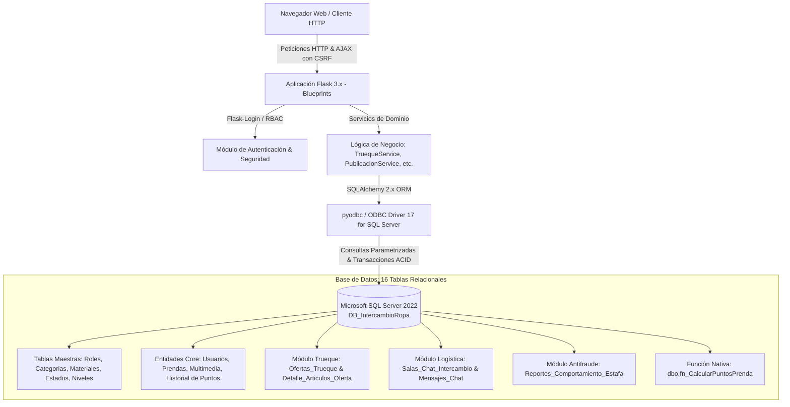

# 🌿 ModaCircular v3.0 - Plataforma Sostenible de Intercambio de Ropa y Accesorios

[](https://www.python.org/)
[](https://flask.palletsprojects.com/)
[](https://www.sqlalchemy.org/)
[](https://www.microsoft.com/sql-server/)
[](https://docs.pytest.org/)
[](LICENSE)

**ModaCircular** es una solución de software orientada a la **economía circular textil y el consumo sostenible**. Permite a los usuarios intercambiar prendas y accesorios mediante dos sistemas complementarios y desacoplados:
1. **Adquisición por Puntos Dinámicos:** Valuación matemática algorítmica sin *hardcoding* calculada directamente en Microsoft SQL Server basada en sostenibilidad, material, estado de conservación y utilidad funcional.
2. **Trueque Directo de Inventario N a M:** Negociación interactiva artículo por artículo con barra de balance de valor referencial en tiempo real, bloqueo preventivo y transacciones atómicas ACID.
3. **Logística y Salas de Chat Auditadas:** Coordinación de entregas presenciales o domiciliarias con transportadora, número de guía y doble confirmación de recibido.
4. **Sistema Pericial Antifraude:** Congelamiento inmutable preventivo de salas en controversia y consola de arbitraje con sanciones y reversión de puntos para el Administrador.

---

## 🏛️ Arquitectura del Sistema

El proyecto sigue una arquitectura modular empresarial desacoplada mediante **Flask Application Factory**, **Blueprints** temáticos, **Capa de Servicios de Dominio** y **SQLAlchemy ORM (v2.x)** conectado a **Microsoft SQL Server 2022** a través del driver `pyodbc`.



---

## 🗄️ Esquema de Base de Datos en SQL Server (16 Tablas)

La base de datos relacional `DB_IntercambioRopa` cuenta con **16 tablas altamente normalizadas**, claves foráneas estrictas, índices de búsqueda y restricciones de verificación (`CHECK`) nativas a nivel de motor:

| # | Tabla SQL Server | Propósito del Negocio |
| :---: | :--- | :--- |
| **1** | `dbo.Roles_Usuario` | Roles del sistema: `ADMINISTRADOR`, `MODERADOR`, `USUARIO`. |
| **2** | `dbo.Usuarios` | Perfiles, credenciales cifradas (scrypt), reputación (`100 pts`), direcciones y doble billetera (puntos disponibles vs retenidos). |
| **3** | `dbo.Categorias_Prenda` | Taxonomía de prendas y accesorios con puntajes base sugeridos. |
| **4** | `dbo.Materiales` | **55 materiales reales** con 12 atributos taxonómicos: sostenibilidad, metales preciosos, bonos y factores multiplicadores. |
| **5** | `dbo.Estados_Aspecto` | Factores multiplicadores de conservación física (`0.20` a `1.00`). |
| **6** | `dbo.Niveles_Utilidad` | Bonos de demanda y versatilidad funcional (`0` a `30 pts`). |
| **7** | `dbo.Prendas_Accesorios` | Artículos publicados en modalidades `SOLO_PUNTOS`, `INVENTARIO_TRUEQUE` o `AMBOS` con estados `PUBLICADA`, `EN_INVENTARIO`, `RESERVADA_TRUEQUE`, `INTERCAMBIADA`, etc. |
| **8** | `dbo.Multimedia_Prenda` | Archivos fotográficos y de video asociados a la comprobación física del artículo. |
| **9** | `dbo.Solicitudes_Aprobacion_Material` | Flujo de certificación y peritaje para piezas de joyería fina y metales preciosos. |
| **10** | `dbo.Transacciones_Adquisicion` | Asiento de adquisición por canje de puntos con comprador, oferente y prenda. |
| **11** | `dbo.Historial_Movimientos_Puntos` | **Kardex contable inmutable:** créditos por publicación, débitos por compra, conversiones de inventario, ajustes y reversiones por fraude (`REVERSION_POR_DISPUTA`). |
| **12** | `dbo.Ofertas_Trueque` | Negociaciones bilaterales de trueque directo con historial de contraofertas y puntos referenciales de momento. |
| **13** | `dbo.Detalle_Articulos_Oferta` | Renglones de artículos comprometidos en un trueque directo (`OFRECIDO` vs `SOLICITADO`). |
| **14** | `dbo.Salas_Chat_Intercambio` | Canales privados post-acuerdo con ficha logística de envío, transportadora, número de guía y doble confirmación. |
| **15** | `dbo.Mensajes_Chat` | Mensajería de soporte con adjuntos y avisos periciales inalterables del sistema. |
| **16** | `dbo.Reportes_Comportamiento_Estafa` | Expediente pericial de denuncias, causales de fraude, evidencias adjuntas, congelamiento pericial y dictámenes. |

---

## 🧮 Motor Matemático de Puntos (Cero Hardcoding)

Ningún cálculo, factor o bono se encuentra quemado en código Python. Toda la tasación reside en la función nativa de base de datos `dbo.fn_CalcularPuntosPrenda`:

$$
\text{Puntos} = \text{REDONDEAR}\Big(\big((\text{Puntaje\_Base} \times \text{Factor\_Material}) + \text{Bono\_Material}\big) \times \text{Factor\_Aspecto} + \text{Bono\_Utilidad}\Big)
$$

- **Determinismo y Trazabilidad:** La función garantiza que un artículo con los mismos atributos obtenga exactamente el mismo valor determinista.
- **Auditoría Contable:** Cada cambio en el saldo de un usuario genera un asiento de auditoría en `dbo.Historial_Movimientos_Puntos` con saldo anterior y posterior.

---

## 🚀 Características Principales v3.0

### 1. Sistema Dual de Publicación
Al registrar una prenda o accesorio, el usuario selecciona libremente su modalidad:
- **Solo Puntos:** Valora el artículo y acredita los puntos de inmediato en la billetera virtual.
- **Inventario para Trueque Directo:** El artículo pasa al estado `EN_INVENTARIO` dentro de la vitrina personal sin alterar el saldo de puntos. Permite conversión transaccional a puntos en cualquier momento.
- **Ambos:** Permite tanto el canje por puntos en el catálogo público como su postulación a trueques directos.

### 2. Constructor de Trueques Directos (N a M)
- **Doble Panel Interactivo:** Selección visual de $N$ artículos propios ofrecidos contra $M$ artículos solicitados de la vitrina de la contraparte.
- **Barra de Equilibrio de Valor:** Indicador dinámico en tiempo real que compara los puntos referenciales de ambas partes.
- **Bloqueo Preventivo:** Durante la oferta activa, las prendas seleccionadas entran en estado `RESERVADA_TRUEQUE` para prevenir doble gasto.
- **Aceptación ACID Atómica:** Reasigna la propiedad de todos los artículos involucrados en una única transacción atómica, bonifica $+10$ puntos de reputación a ambos y crea automáticamente la sala de chat de coordinación.

### 3. Logística de Envíos y Salas de Chat
- Apertura automática de sala privada tras una compra con puntos o un trueque aceptado.
- **Ficha Logística Integrada:** Registro de modalidad de entrega (presencial o a domicilio), empresa transportadora, número de guía de despacho, destinatario y dirección.
- **Doble Confirmación de Entrega:** Bonifica $+5$ puntos de reputación a ambas partes al confirmar la recepción del artículo y archiva exitosamente la sala (`CERRADA_EXITOSA`).

### 4. Sistema Pericial Antifraude y Disputas
- Cualquier participante puede radicar una denuncia por presunto fraude (`INTENTO_ESTAFA`, `ARTICULO_FALSIFICADO_O_DISTINTO`, `NO_ENVIO_O_INCUMPLIMIENTO`, `LENGUAJE_OFENSIVO_O_ACOSO`, `SOLICITUD_DINERO_EXTERNO`) adjuntando pruebas fotográficas.
- **Congelamiento Inmutable:** La sala pasa a `'EN_DISPUTA_AUDITORIA'`, bloqueando el envío de mensajes ordinarios y congelando la información para preservar la evidencia.
- **Consola del Administrador (`/admin/disputas`):** El Administrador revisa el chat inmutable, la evidencia y emite dictamen:
  - *Desestimar:* Reactiva la sala a `ACTIVA`.
  - *Advertencia Formal:* $-20$ puntos de reputación al infractor.
  - *Suspensión Temporal:* Bloqueo de cuenta por 3, 7, 15 o 30 días, cancelación por fraude y $-40$ pts de reputación.
  - *Expulsión Definitiva:* Bloqueo total de la cuenta.
  - *Reversión Contable:* Reembolsa puntos al afectado y debita al infractor (`REVERSION_POR_DISPUTA`).

### 5. CRUD Total de Administración
El Panel de Administración (`/admin/tablas` y `/admin/usuarios`) ofrece gestión completa en pantalla para:
- Categorías de Prendas y Accesorios.
- Catálogo de 55 Materiales con sus 12 columnas taxonómicas.
- Factores de Conservación y Niveles de Utilidad.
- Usuarios: Creación, asignación de roles (`ADMINISTRADOR`, `MODERADOR`, `USUARIO`), ajuste auditado de saldos y suspensiones temporales o permanentes.

---

## 🎨 Diseño Visual Vibrante (+30% Color)

- **Tipografía Abierta:**
  - Títulos y encabezados: **`Plus Jakarta Sans`** (Google Fonts).
  - Interfaz y lectura: **`Nunito`** (Google Fonts).
- **Paleta Cromática Armónica:**
  - 🟢 **Verde Esmeralda Vivo (`#10B981` / `#059669`):** Acciones positivas, billetera disponible y aprobaciones.
  - 🔵 **Turquesa Radiante (`#06B6D4` / `#0891B2`):** Fichas logísticas de transporte y trueques directos.
  - 🟡 **Ámbar Cálido (`#F59E0B`):** Puntos dinámicos e indicadores de espera.
  - 🟣 **Violeta Joyería (`#8B5CF6`):** Metales y piedras preciosas de alta gama.
  - 🔴 **Carmesí Antifraude (`#EF4444`):** Salas en disputa y expedientes periciales.
- **UI Responsiva:** Bordes suaves de `16px`, elevación por sombras suaves y compatibilidad multidispositivo completa con Bootstrap 5.

---

## ⚙️ Instalación y Puesta en Marcha Local

### Prerrequisitos
- **Python 3.11+** (Probado y optimizado en Python 3.13.14).
- **Microsoft SQL Server 2019 / 2022** con instancia activa (ej. `localhost\SQLEXPRESS`).
- **ODBC Driver 17 for SQL Server** instalado en el sistema operativo.

### 1. Clonar el Repositorio
```bash
git clone https://github.com/Bladimirtrespa/modacircular.git
cd modacircular
```

### 2. Configurar Entorno Virtual e Instalar Dependencias
```bash
# Crear entorno virtual
python -m venv venv

# Activar entorno (Windows PowerShell)
.\venv\Scripts\Activate.ps1

# Instalar librerías
pip install -r requirements.txt
```

### 3. Configurar Variables de Entorno (`.env`)
Crear un archivo `.env` en la raíz del proyecto basado en `.env.example`:
```ini
FLASK_ENV=desarrollo
SECRET_KEY=clave_secreta_super_segura_modacircular_2026
DB_SERVER=Principal001\SQLEXPRESS
DB_NAME=DB_IntercambioRopa
DB_DRIVER=ODBC Driver 17 for SQL Server
DB_TRUSTED_CONNECTION=yes
PUERTO=5000
```

### 4. Inicializar y Migrar la Base de Datos en SQL Server
Ejecutar el script de migración automática a 16 tablas y carga de taxonomía:
```bash
# 1. Crear / actualizar las 16 tablas y la función nativa de puntos
python actualizar_bd_v3.py

# 2. Sembrar catálogo taxonómico de 55 materiales y usuarios de prueba
python seed_db.py

# 3. Comprobar diagnóstico de salud en SQL Server
python prueba_sqlserver.py
```

### 5. Iniciar Servidor de Desarrollo
```bash
python run.py
```
Abrir en el navegador: 👉 **[http://localhost:5000](http://localhost:5000)**

---

## 👥 Cuentas de Acceso Predeterminadas (Entorno de Pruebas)

| Rol | Correo Electrónico | Contraseña | Capacidades |
| :--- | :--- | :--- | :--- |
| **Administrador** | `bladimir@intercambioropa.co` | `Admin1234*` | CRUD Total de Tablas Maestras, Bandeja de Disputas & Fraude, Gestión de Usuarios y Moderación. |
| **Usuario 1** | `carlos.restrepo@correo.com` | `Usuario1234*` | Publicación dual, vitrina personal de trueque directo, negociación y chat logístico. |
| **Usuario 2** | `maria.gomez@correo.com` | `Maria123*` | Trueque directo bilateral, confirmación de entrega y reporte de disputas. |

---

## 🧪 Certificación de Pruebas Automatizadas (Pytest)

El sistema incluye una suite de pruebas automatizadas que valida al 100% las 16 tablas, el motor de puntos, la transaccionalidad ACID, el constructor de trueques directos, la mensajería y la auditoría antifraude.

Para ejecutar todas las pruebas:
```bash
python -m pytest -v
```

**Resultado de Certificación:**
```
tests/test_admin_y_suspension.py::test_creacion_material_admin_12_columnas PASSED
tests/test_admin_y_suspension.py::test_suspension_temporal_usuario_y_bloqueo PASSED
tests/test_admin_y_suspension.py::test_suspension_permanente_usuario PASSED
tests/test_admin_y_suspension.py::test_ajuste_saldo_con_asiento_contable_historial PASSED
tests/test_adquisicion_y_kardex.py::test_adquisicion_exitosa_con_puntos PASSED
tests/test_adquisicion_y_kardex.py::test_bloqueo_adquisicion_prenda_propia PASSED
tests/test_adquisicion_y_kardex.py::test_bloqueo_saldo_insuficiente PASSED
tests/test_auditoria_y_disputas.py::test_reporte_estafa_congela_sala_y_bloquea_mensajes PASSED
tests/test_auditoria_y_disputas.py::test_resolucion_disputa_admin_con_sancion PASSED
tests/test_autenticacion.py::test_registro_usuario_exitoso PASSED
tests/test_autenticacion.py::test_rechazo_registro_correo_duplicado PASSED
tests/test_autenticacion.py::test_inicio_sesion_y_cierre PASSED
tests/test_chat_y_logistica.py::test_ciclo_completo_chat_y_logistica PASSED
tests/test_inventario_y_conversion.py::test_publicacion_inventario_y_conversion_a_puntos PASSED
tests/test_motor_puntos.py::test_calculo_formula_enriquecida_prenda_estandar PASSED
tests/test_motor_puntos.py::test_bloqueo_retencion_joyeria_preciosa PASSED
tests/test_motor_puntos.py::test_incompatibilidad_material_con_tipo_articulo PASSED
tests/test_publicacion_y_moderacion.py::test_publicacion_prenda_acreditacion_inmediata PASSED
tests/test_publicacion_y_moderacion.py::test_publicacion_joyeria_y_aprobacion_moderador PASSED
tests/test_trueques_csgo.py::test_flujo_completo_trueque_csgo PASSED
tests/test_trueques_csgo.py::test_rechazo_y_liberacion_trueque PASSED

============================== 21 PASSED in 4.30s (100% Éxito) ==============================
```

---

## 👨‍💻 Autor & Créditos

- **Desarrollador Principal:** Bladimir Albanis Trespalacio Carvajal
- **Correo Institucional:** `bladimirtrespalacio240073@correo.itm.edu.co`
- **Correo de Plataforma:** `bladimir@intercambioropa.co`
- **Institución:** Instituto Tecnológico Metropolitano (ITM) - Facultad de Ingenierías

---

## 📄 Licencia

Este proyecto se distribuye bajo la licencia **MIT**. Consulta el archivo [`LICENSE`](LICENSE) para más información.

Desarrollado para el impulso de la **moda circular, la sostenibilidad ambiental y la ingeniería de software robusta**.
